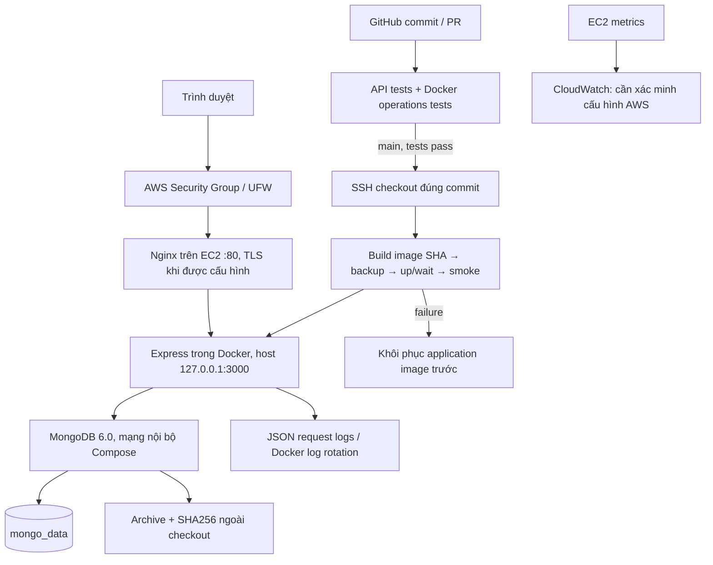

# Kiến trúc cuối — Docker Compose

Nginx chạy trên host; Docker quản lý app và DB, thay vai trò PM2 ở tuần 1. `diagram.png` được giữ làm minh chứng lịch sử tuần 1; sơ đồ Mermaid trên là kiến trúc hiện tại.

App chạy user `node`, filesystem chỉ đọc, bỏ Linux capabilities. Chỉ host loopback được publish cổng app; MongoDB không có mapping cổng. Volume lưu dữ liệu qua lần tạo lại container. Tên project mặc định lấy từ thư mục `devops-note-api`, vì vậy không đổi tên project trên EC2 hiện hữu.

Readiness `/health` ping DB và chứa SHA phiên bản. `/live` chỉ phản ánh tiến trình HTTP. Docker dùng readiness để kiểm tra triển khai; trạng thái unhealthy tự nó không làm Docker restart, nên cần monitoring/cảnh báo. Restart policy chỉ phục hồi khi tiến trình dừng, không phải giải pháp cho mọi lỗi tài nguyên.

CI có database riêng cho API test và project Compose riêng cho thử nghiệm có xóa dữ liệu. Pipeline production chỉ kiểm tra đọc HTTP; không cố tình gây lỗi hoặc xóa dữ liệu người dùng.
