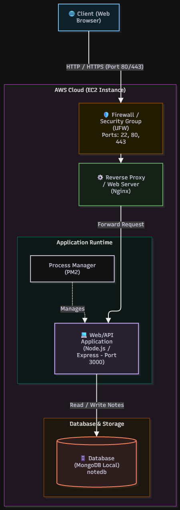

# Kiến trúc Smart Note Web App

Smart Note cho phép người dùng tạo, xem và xóa ghi chú trên trình duyệt. **Nginx** nhận yêu cầu web trên máy chủ AWS EC2, **Express** phục vụ giao diện và xử lý API, còn **MongoDB** lưu dữ liệu trong database `notedb`.

## Sơ đồ triển khai tuần 1

Đọc sơ đồ từ trên xuống theo đường đi của yêu cầu. Mũi tên nét đứt từ PM2 tới Express mô tả việc quản lý tiến trình. Yêu cầu HTTP đi từ Nginx thẳng tới Express.

| Thành phần | Vai trò trong sơ đồ |
| --- | --- |
| Trình duyệt | Tải giao diện, gửi yêu cầu lưu, xem hoặc xóa ghi chú, rồi cập nhật giao diện từ kết quả API. |
| AWS Security Group và UFW | Security Group kiểm soát lưu lượng đến EC2. UFW lọc lưu lượng trên Ubuntu. Sơ đồ ghi cổng `80` cho HTTP, `443` cho HTTPS và `22` cho SSH quản trị. Cổng 443 trong sơ đồ thể hiện vai trò của HTTPS. Cấu hình TLS thực tế phụ thuộc vào Nginx và chứng chỉ trên EC2. |
| Nginx | Nhận lưu lượng web và chuyển tiếp qua `proxy_pass` tới Express ở cổng `3000`. Phản hồi API quay về trình duyệt qua Nginx. |
| Node.js, Express và PM2 | Express phục vụ giao diện từ `public/` và định nghĩa các route trong `server.js`. Trong triển khai tuần 1, PM2 khởi chạy và quản lý tiến trình Node.js trên Ubuntu. |
| MongoDB | Express dùng Mongoose để đọc và ghi dữ liệu. MongoDB cục bộ lưu ghi chú trong database `notedb`; trình duyệt giao tiếp với Express qua HTTP. |

## Luồng lưu một ghi chú

1. Người dùng mở địa chỉ web của EC2. Yêu cầu đi qua Security Group và UFW tới Nginx. Nginx chuyển tiếp tới Express, nơi phục vụ trang `public/index.html`.
2. Khi người dùng bấm **Lưu ghi chú**, trình duyệt gửi `POST /notes` với dữ liệu JSON gồm tiêu đề, nội dung và danh mục nếu có.
3. Express nhận dữ liệu và gọi Mongoose để tạo bản ghi trong MongoDB. Sau khi lưu thành công, API trả `201 Created` cùng ghi chú đã lưu.
4. Khi tải danh sách, trình duyệt gọi `GET /notes`. API đọc dữ liệu từ MongoDB và trả các ghi chú mới nhất trước. Khi xóa, trình duyệt gọi `DELETE /notes/:id`; API trả `404` nếu ID hợp lệ nhưng ghi chú đã không còn.

## Triển khai bằng Docker Compose từ tuần 2

Trong [cấu hình Compose](../../docker-compose.yml), Node.js chạy trong service `app` và MongoDB 6.0 chạy trong service `db`. Nginx được cấu hình trên máy EC2 theo hướng dẫn ở [README chính](../../README.md). Compose publish cổng `3000` của app trên host để Nginx chuyển tiếp tới API.

- **Kết nối nội bộ.** Hai service dùng mạng `note-network`. Biến môi trường `MONGO_URI` trỏ tới `mongodb://db:27017/notedb`. Docker phân giải `db` thành địa chỉ của service MongoDB. Compose không publish cổng `27017` ra host.
- **Quản lý tiến trình.** Docker khởi chạy Node.js theo [Dockerfile](../../Dockerfile). Compose đặt `restart: always` cho app và DB. Khối PM2 trong sơ đồ áp dụng cho triển khai trực tiếp ở tuần 1.
- **Lưu dữ liệu.** Volume `mongo_data` được gắn vào `/data/db` của MongoDB để dữ liệu tồn tại qua lần tạo lại container. Lệnh `docker compose down` giữ named volume theo mặc định, còn `docker compose down -v` xóa volume do Compose quản lý.
- **Deploy.** [GitHub Actions](../../.github/workflows/deploy.yml) chạy test khi có push lên `main`. Khi test thành công, job deploy kết nối EC2 qua SSH, đồng bộ mã nguồn và chạy lại Docker Compose.

## Kiểm tra từng lớp khi có sự cố

| Quan sát | Bước kiểm tra tiếp theo |
| --- | --- |
| Trình duyệt không kết nối được | Kiểm tra địa chỉ EC2, cổng web trong Security Group và UFW, rồi kiểm tra Nginx có lắng nghe hay không. |
| Nginx trả `502 Bad Gateway` | Kiểm tra `docker compose ps`, log của `app` và thử `curl -i http://localhost:3000/health` trực tiếp trên EC2. |
| `GET /health` trả `200` nhưng `GET /notes` lỗi hoặc timeout | `/health` hiện chỉ cho biết Express còn phản hồi. Kiểm tra trạng thái và log của `db`, sau đó kiểm tra kết nối MongoDB trong log của `app`. |

Xem [mã nguồn API](../../server.js) và [playbook vận hành](../playbook.md) để đối chiếu các route và quy trình xử lý sự cố.
